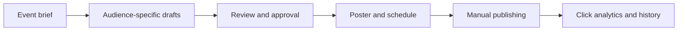
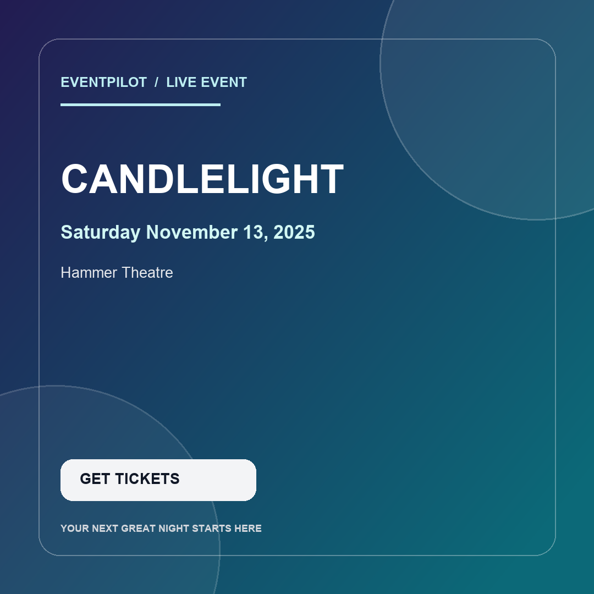

# EventPilot AI

**An event campaign workspace for social media managers**  
EventPilot helps a social media manager turn one event brief into audience-specific post ideas, prepare a visual, collect review, plan manual publishing, and see whether tracked ticket links get clicks.

## Why EventPilot

Promoting events means repeatedly coming up with fresh ways to reach different people, keeping event details accurate, coordinating review, and remembering when each post should go out. EventPilot puts those steps in one workspace. It gives the person managing social media a starting point for engagement ideas and tailored captions, then helps organize the work through review, scheduling, and basic click measurement.

Generated copy and imagery are drafts for a person to review. EventPilot does not verify event facts through Google, promise engagement, or publish to social accounts automatically.

## What it does

- Creates tailored social copy for **regulars**, **first-time attendees**, and **students**.
- Uses a configurable LLM provider. Ollama is the zero-API-cost default; optional provider examples are documented in `src/llm.py`.
- Creates a branded poster locally with Pillow and an abstract background, with no image API required.
- Lets you add a relevant event photo as the poster background, with a dark overlay to keep event details readable.
- Can generate an optional AI background from the event brief when `OPENAI_API_KEY` is configured. This sends the event name, date, venue, and description to OpenAI; API use may incur charges.
- Saves events, campaign variants, scheduled-post drafts, and click events in SQLite.
- Provides reviewer decisions, a monthly schedule, rescheduling and cancellation, a manual publishing checklist, and publishing history.
- Shows overdue and upcoming-post reminders while the app is open.
- Adds tracked ticket links and analytics for clicks recorded by this app.
- Keeps publishing manual. Instagram and Meta accounts are not connected.

## Stack

Python 3.11+, Streamlit, Ollama, SQLite, Pillow, pandas, python-dotenv.

## Quick start

### 1. Check Python and Ollama

Install Python 3.11 or newer and Ollama from https://ollama.com.

In Terminal, check the local models:

```bash
ollama list
```

If your installed model is listed, use its exact name in `.env`. If you want the Llama 3.1 8B model and have enough memory, you can pull it:

```bash
ollama pull llama3.1:8b
```

Llama 3.1 8B is a roughly 5 GB download in its common quantized form. You do not need to download it if you already have a suitable model.

### 2. Create the environment

macOS / Linux:

```bash
python3 -m venv .venv
source .venv/bin/activate
python -m pip install --upgrade pip
pip install -r requirements.txt
cp .env.example .env
```

Windows PowerShell:

```powershell
py -3 -m venv .venv
.venv\Scripts\Activate.ps1
python -m pip install --upgrade pip
pip install -r requirements.txt
Copy-Item .env.example .env
```

Edit `.env` and set `OLLAMA_MODEL` to the exact model shown by `ollama list`.

### 3. Start Ollama

Open another terminal and ensure Ollama is running. Usually the Ollama desktop app starts the local service automatically. Test it with:

```bash
ollama run llama3.1:8b
```

Replace the model name with your installed model.

### 4. Run EventPilot AI

From the project directory with `.venv` activated:

```bash
streamlit run app.py
```

Streamlit will print a local URL, usually http://localhost:8501.

## How to use it

1. In **Create Campaign**, enter the event name, date and time, venue, description, ticket URL, platform, and audience segments.
2. Generate captions. EventPilot creates one draft for each selected audience. Review and edit the drafts; use **Generate again** for a fresh set or **Clear drafts** to discard the editor contents.
3. Choose a poster background: the local abstract design, a photo you upload, or an AI-generated background. The poster text is added by EventPilot after the background is created.
4. Save the caption variants. Find them in **Campaign Library**.
5. In the library, enter a reviewer name and approve the captions you want to use. The reviewer can also request changes and leave a note.
6. In **Scheduled Posts**, choose an approved caption and time. Use the calendar to review the month; edit or cancel scheduled items as plans change.
7. Before publishing, complete the caption, media, and platform checklist. Publish manually in the social network, then mark the post as published in EventPilot. Review decisions and publishing records appear in **Publishing History**.
8. Check the overview for posts due soon or overdue. Use **Campaign Analytics** to compare campaign statuses and tracked ticket-link clicks.

## Visual tour

The workflow moves from an event brief to reviewed, scheduled content and then to click reporting:



Example of a locally composed event poster:



The poster above uses the local abstract background. In the app, you can also upload a photo or generate an AI background.

## Example campaign generation

The following fictional brief shows how one event can produce different starting captions for different audiences. Replace these details with the event information you provide in **Create Campaign**.

**Brief:** Jazz Night at the Student Center, Friday at 7 PM. A live jazz performance and social evening. Tickets: `https://example.com/tickets`.

**Regulars**

> Make Friday a familiar favorite with Jazz Night at the Student Center. Join us for a live jazz performance and an easygoing evening with the event community. Bring a friend, settle in, and enjoy the music. Get your tickets: https://example.com/tickets
>
> #JazzNight #LiveMusic #CommunityEvents

**First-timers**

> Curious about live jazz? Start with Jazz Night at the Student Center this Friday at 7 PM. Come as you are, enjoy the performance, and make a relaxed evening of it. It’s a welcoming way to try something new and meet other music fans. Get your tickets: https://example.com/tickets
>
> #JazzNight #LiveJazz #ThingsToDo

**Students**

> Need a Friday night plan? Jazz Night brings live music to the Student Center at 7 PM. Invite a friend, take a break from the week, and enjoy an evening of jazz together. Check the event page for ticket details: https://example.com/tickets
>
> #StudentEvents #JazzNight #CampusLife

These are sample drafts, not guaranteed model output. Review dates, venue details, tone, links, and any claims before publishing.

The schedule is a planning queue. It does not run a background job, send notifications, or publish posts while the app is closed. Times use the computer's local timezone. Reviewer names are entered manually; the app does not have user accounts or role-based permissions.

The tracking URL points to this local app. Clicks can be measured on your machine, but remote attendees cannot reach your laptop unless you deploy the app to a public host. For real-world testing, deploy the app and use a public HTTPS base URL.

## Model switching

Set these values in `.env`:

```dotenv
LLM_PROVIDER=ollama
OLLAMA_BASE_URL=http://localhost:11434
OLLAMA_MODEL=llama3.1:8b
```

The provider interface lives in `src/llm.py`. The Ollama implementation is active by default. Optional Gemini, Groq, and OpenAI examples are kept in comments in that file so you can experiment later. Add the relevant key to `.env` only when you choose to use a paid or free-tier cloud provider.

## Enable AI-generated poster backgrounds

AI backgrounds are optional. Add an OpenAI API key to the local `.env` file, then restart Streamlit:

```dotenv
OPENAI_API_KEY=your-key-here
```

Select **AI-generated** under **Poster background**. EventPilot asks the image API for a text-free scene based on the event brief, then adds the title, date, and venue locally. Image requests can incur API charges. If you do not configure a key, the uploaded-photo and abstract options remain available.

## Instagram publishing: important reality check

Instagram and Facebook publishing are not enabled. Posts marked as published in this app are records of manual publishing, not confirmation from a social network. A future Meta integration would require an eligible account, developer app, permissions, and an official publishing adapter.

## Project layout

```text
eventpilot-ai/
├── app.py                  # Streamlit UI
├── requirements.txt
├── .env.example
├── .gitignore
├── src/
│   ├── __init__.py
│   ├── db.py               # SQLite schema and queries
│   ├── llm.py              # Swappable model provider
│   ├── campaign.py         # Prompt and audience campaign generation
│   ├── visuals.py          # Local poster composition and optional AI backgrounds
│   └── tracking.py         # Tracked ticket links and click recording
├── data/                   # SQLite database created on first run
├── generated/              # Campaign images created locally
└── tests/                  # Campaign, publishing workflow, and poster tests
```

## Resume bullets (use only after you have tested the project)

- Built **EventPilot AI**, a local-first event marketing platform that generates audience-segmented social campaigns with a swappable LLM provider architecture and SQLite-backed campaign management.
- Developed click-tracking and campaign analytics workflows to measure engagement by event and audience variant, with local branded image generation and a review-first publishing queue.
- Designed a provider abstraction supporting local inference through Ollama and documented extension points for cloud model APIs and official Instagram publishing.

Click analytics only count visits to the ticket links recorded by this app. They do not report social reach, impressions, or engagement on Instagram/Facebook. For people outside your computer to open tracked links, deploy the app and configure a public HTTPS base URL.

## Troubleshooting

- **Ollama connection error:** Open the Ollama app, then run `ollama list`. Check `OLLAMA_BASE_URL`.
- **Model not found:** Set `OLLAMA_MODEL` to the exact name shown by `ollama list`.
- **Model responds slowly:** Use a smaller model already installed, reduce `MAX_TOKENS`, and close memory-heavy apps.
- **AI background is unavailable:** Check that `OPENAI_API_KEY` is set in `.env`, restart Streamlit, and confirm your API account can use image generation.
- **Python install errors:** Use Python 3.11 or 3.12 in a fresh virtual environment.
- **Reset local demo data:** Stop Streamlit, then delete `data/eventpilot.db`. This deletes local campaigns and click history.
